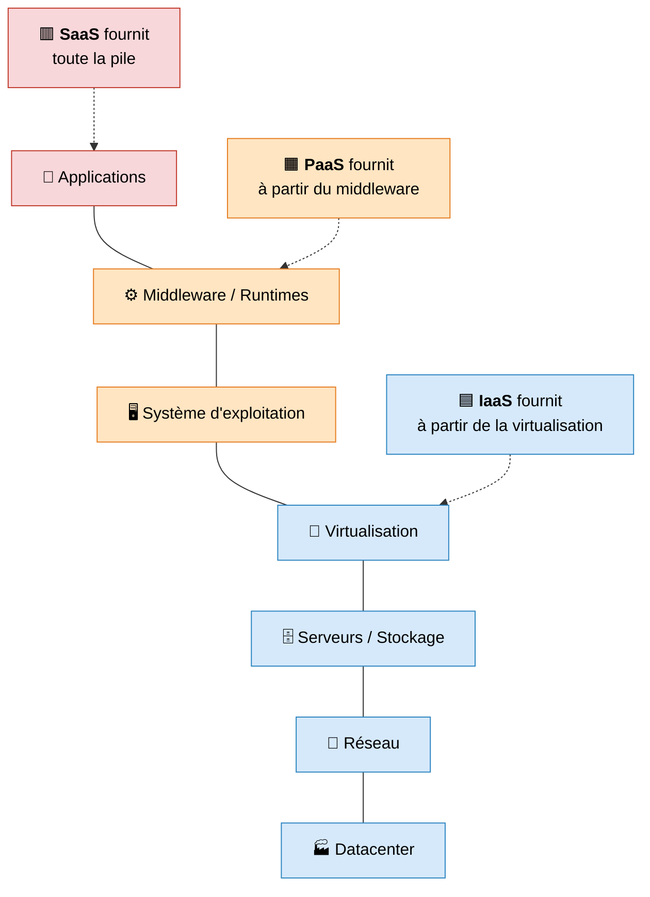
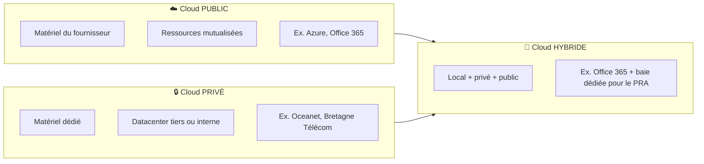
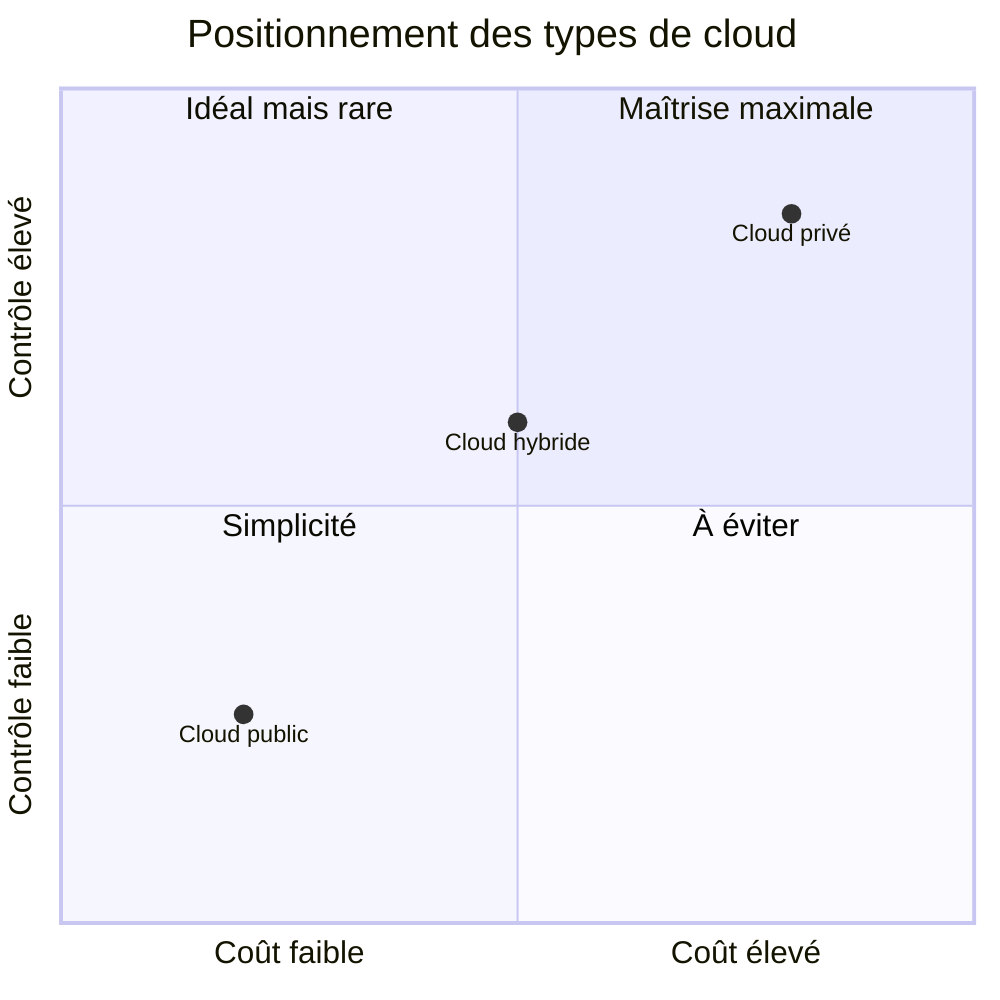
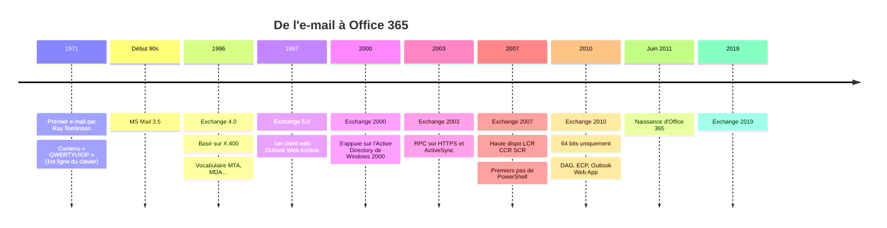
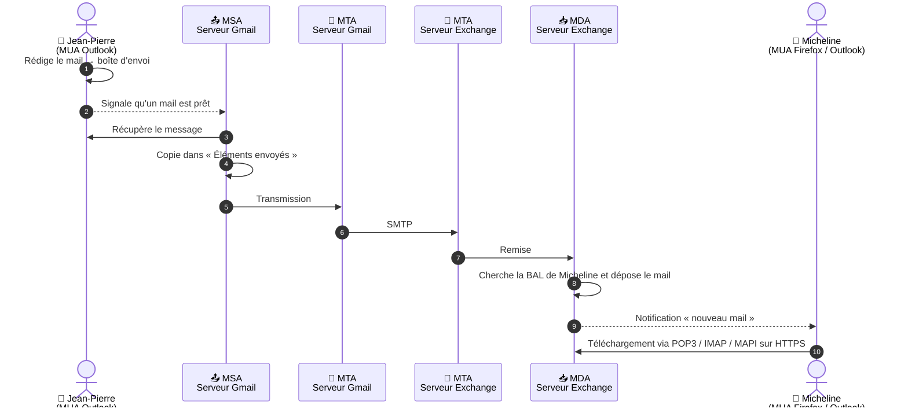
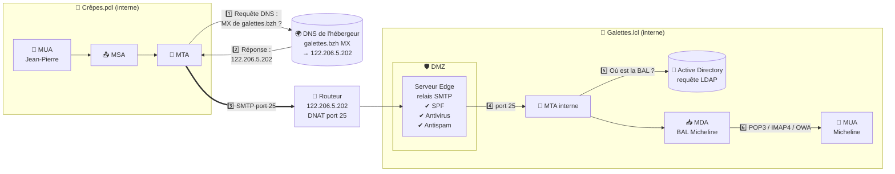

# Module 1 : Les composantes du Cloud et de Microsoft 365

*Cours : [Cours 14 - Messagerie Cloud](../index.md)*

## 🎯 Objectif du module

Ce module pose les bases nécessaires à la compréhension du Cloud et de Microsoft 365. Nous étudions les principaux modèles de service (SaaS, PaaS, IaaS) ainsi que les différents types d'infrastructures Cloud (public, privé, hybride). Nous approfondissons ensuite le fonctionnement de la messagerie électronique : son historique, le vocabulaire des serveurs de messagerie (MUA, MSA, MTA, MDA), les enregistrements DNS nécessaires à l'acheminement des mails, et le détail des flux internes et externes. Enfin, nous mettons en pratique ces notions en créant notre propre tenant Microsoft 365, de l'achat d'un nom de domaine jusqu'à la vérification des enregistrements DNS associés.

## 🖼️ Résumé visuel






## 📖 Cours consolidé

## 1. Qu'est-ce que le Cloud ?

Le Cloud, par essence, fournit de la **puissance de calcul** (processeurs, RAM, GPU) ainsi que du **stockage** et des **logiciels**, accessibles à distance. Le cloud computing apporte une grande souplesse : il est possible d'ajouter ou de retirer des ressources, ou d'installer des machines virtuelles, en toute simplicité.

### 1.1 Avantages du Cloud

Le choix entre héberger son infrastructure localement, gérer quelques services installés, ou se limiter à des applications distantes dépend des compétences disponibles et des besoins de l'entreprise. Le Cloud offre des avantages en matière de sécurité, en particulier pour la **disponibilité des données**, grâce à la redondance du réseau internet, des datacenters, et à un approvisionnement électrique sécurisé par générateurs.

📌 Des incidents récents, comme celui d'OVH, rappellent que cette disponibilité reste théorique et doit être questionnée plutôt que considérée comme acquise.

Les datacenters sont classés selon un **niveau de garantie de disponibilité** (*uptime*) :

| Niveau | Disponibilité attendue | Temps d'arrêt annuel |
|---|---|---|
| **Niveau 1** | 99,67 % | 28,8 heures |
| **Niveau 2** | 99,75 % | 22 heures |
| **Niveau 3** | 99,982 % | 1,6 heure |
| **Niveau 4** | 99,995 % | 26,3 minutes |

Plus le niveau augmente, plus l'infrastructure (redondance électrique, réseau, climatisation) est robuste — et plus le coût de l'hébergement est élevé.

### 1.2 Modèle économique du Cloud

La facturation est dimensionnée en fonction de l'utilisation, ce qui permet une gestion financière plus prévisible : les coûts augmentent en période de croissance (plus de stockage consommé) et diminuent en période de décroissance. La gestion du matériel n'est plus à la charge de l'entreprise — fini l'obsolescence matérielle ou les achats imprévus, l'hébergeur prenant en charge ces problématiques.

### 1.3 Questions à se poser avant de migrer vers le Cloud

- Où sont stockées nos données ? Sont-elles répliquées ?
- Quelles garanties de sécurité sont mises en place pour l'accès aux datacenters ? (Par exemple, les données médicales exigent un datacenter certifié **HDS**.)
- Comment gérer une coupure internet si l'entreprise est entièrement hébergée dans le Cloud ?

⚠️ Une dépendance totale au Cloud expose l'entreprise à une perte d'accès à ses services et données en cas de coupure de ligne internet.

---

## 2. Le modèle SPI — SaaS / PaaS / IaaS

Le modèle **SPI** désigne les trois grandes catégories de services proposées par le Cloud Computing : **SaaS**, **PaaS** et **IaaS**. Chaque modèle correspond à un niveau de responsabilité différent, représenté classiquement par une pyramide : plus on descend vers l'IaaS, plus le public ciblé est technique (administrateurs systèmes et réseaux), et plus on monte vers le SaaS, plus le public est large (utilisateurs finaux).

| Modèle | Public cible | Ce qui est géré par le fournisseur | Exemples |
|---|---|---|---|
| **SaaS** (Software as a Service) | Utilisateurs finaux | Applications hébergées (tout, jusqu'à l'application) | Gmail, Office 365, Trello, Slack |
| **PaaS** (Platform as a Service) | Développeurs | Outils de développement, bases de données, OS, virtualisation, serveurs, réseau | Heroku, OpenShift, Cloud Foundry |
| **IaaS** (Infrastructure as a Service) | Architectes réseaux / administrateurs systèmes | Bâtiment, matériel, réseau, sécurité/pare-feu | AWS, Azure, VMware, Stackscale |

Un schéma en couches permet de visualiser précisément ce que chaque modèle laisse à la charge du client par rapport à un hébergement **sur site** (*on-premise*) : dans tous les cas, « Applications » et « Données » restent la responsabilité du client, mais à mesure que l'on monte dans le modèle SPI, de plus en plus de couches basculent « dans le Cloud » (réseau, stockage, serveurs, virtualisation, puis OS et middleware pour le PaaS, puis l'application elle-même pour le SaaS).

### 2.1 SaaS : Software as a Service

Le SaaS désigne la mise à disposition d'**applications accessibles via Internet** (ex. Office 365 pour la messagerie, Sage pour la comptabilité, G Suite). L'utilisateur ne gère que l'accès à l'application ; l'hébergeur prend en charge la mise à jour et le maintien de la solution.

| Avantages | Inconvénients |
|---|---|
| Pas d'administration — idéal pour les petites entreprises sans service informatique | Dépendance totale à l'éditeur (changement de version, arrêt du service, indisponibilités) |
| Disponibilité proche de 100 % | Dépendance à l'accès Internet |
| Évolution des produits dans le temps | Question de la confidentialité des données |
| Pas de contraintes matérielles (stockage, obsolescence, performance) | ROI qui croise à environ 4 ans |
| Coût maîtrisé et aligné sur la consommation | |

### 2.2 PaaS : Platform as a Service

Le PaaS offre des **environnements de développement**, systèmes d'exploitation ou outils de gestion de bases de données à configurer et gérer. Il permet de se concentrer sur le développement sans se soucier des infrastructures sous-jacentes.

| Avantages | Inconvénients |
|---|---|
| Économies sur les licences logicielles à l'achat | Dépendance à l'accès Internet |
| Flexibilité | Question de la confidentialité des données |
| Sécurité assurée par le fournisseur | |
| Facilité de mise en œuvre | |

### 2.3 IaaS : Infrastructure as a Service

L'IaaS permet d'accéder à des **ressources matérielles et logicielles** : l'hébergeur se charge de la maintenance et de la sécurité des infrastructures (plus besoin de climatisation ou d'alimentation électrique interne), le client se concentrant sur l'installation de ses systèmes.

| Avantages | Inconvénients |
|---|---|
| Pas besoin d'aménager une salle serveur | Dépendance totale à l'hébergeur |
| Sécurité du matériel assurée par le fournisseur | Dépendance à l'accès Internet |
| Garanties de disponibilité | Question de la confidentialité des données |
| Pas d'obsolescence du matériel | |
| Évolutivité à la demande | |

⚠️ Avec un modèle facturé à la consommation (ex. Azure), il faut rester vigilant sur le **volume de données échangées** et le **temps de démarrage des machines virtuelles**, afin d'anticiper les coûts.

---

## 3. Types de Cloud — public, privé, hybride

### 3.1 Comparatif des types de Cloud

| Critère | Cloud public | Cloud privé | Cloud hybride |
|---|---|---|---|
| **Principe** | Ressources hébergées et fournies par un prestataire | Matériel dédié dans un datacenter tiers ou interne | Combinaison d'hébergement local, de cloud privé et de cloud public |
| **Propriété du matériel** | Fournisseur de services | Entreprise (achat ou location d'équipements spécifiques) | Mixte, selon les briques choisies |
| **Mutualisation** | Oui, ressources partagées | Non, matériel dédié | Partielle |
| **Évolutivité** | Quasi illimitée, limitée par la taille physique des baies du fournisseur | Dépend d'investissements importants et de la place disponible dans la baie | Flexible : on choisit la solution adaptée à chaque besoin |
| **Fiabilité / maintenance** | Garantie par l'hébergeur ; les pannes matérielles ne sont pas à notre charge | À notre charge : fiabilité et sécurité de l'infrastructure | Partagée entre le fournisseur et l'entreprise |
| **Sécurité** | Dépend du fournisseur, matériel partagé | Renforcée, car le matériel n'est pas mutualisé | Maîtrisée : données sensibles en privé, le reste en public |
| **Coûts** | Faibles (pas de matériel à maintenir), facturation à la consommation | Élevés (investissements, maintenance) | Optimisés, gestion plus fine selon les besoins et le budget |
| **Points de vigilance** | Volume de données échangées et temps d'allumage des VM, qui font grimper la facture (ex. Azure) | Saturation de la baie : s'étendre peut imposer une nouvelle baie dans un autre datacenter | Bien anticiper les évolutions de l'infrastructure pour investir judicieusement |
| **Profil type** | Toute entreprise voulant éviter la gestion du matériel | Grandes entreprises (datacenter interne) ou location chez un tiers | Entreprise cherchant à équilibrer coûts, sécurité et performances |
| **Exemples** | Azure, Office 365 | Datacenters Oceanet, Bretagne Télécom | Office 365 + baie dédiée en datacenter pour le PRA |

Le **cloud hybride** combine ainsi hébergement local, cloud privé et cloud public afin de mieux maîtriser les coûts, la sécurité et les performances — par exemple en utilisant Office 365 (cloud public) tout en conservant une baie dédiée dans un datacenter pour assurer la continuité de service, notamment dans le cadre d'un **plan de reprise d'activité (PRA)**.



### 3.2 Héberger en local ou dans le Cloud ?

La question de l'hébergement local n'a pas de réponse universelle : tout dépend des cas d'usage. En cas d'hébergement Cloud, l'entreprise devient fortement dépendante de la qualité de son accès Internet (débit et fiabilité).

**Avantages de l'hébergement en interne :**
- Maîtrise totale de l'environnement matériel et OS
- Montées de version contrôlées
- Investissement initial, sans notion de « location » pour la mise à disposition des services
- Ajout de nouveaux services « gratuitement », sous réserve de disponibilité du matériel

**Contraintes de l'hébergement en interne :**
- Obsolescence du matériel (puissance, usure, périodes de garantie)
- Nécessité de disposer d'une salle serveur : fermée à clé, climatisée, équipée d'un pare-feu adapté, d'un onduleur (coupures électriques), avec un plancher dimensionné pour le poids de la baie
- Sécurité à assurer soi-même, tant applicative (pare-feu) que physique (électricité, refroidissement, accès)

**Questions à se poser pour faire son choix :**
- Quelle est la criticité assumée des données/applications ?
- Quel niveau de disponibilité est demandé pour les serveurs et applications ?
- Quelles sont les exigences de performance des applications ?
- Disposons-nous d'une salle serveur ? Avons-nous du matériel, est-il encore sous garantie ?
- Prenons-nous le risque de travailler avec du matériel hors garantie (budget maintenance difficile à quantifier) ?
- Quels sont la fiabilité et le débit de notre ligne Internet ? Avons-nous des garanties (GTR) sur notre ligne Web ?
- Sommes-nous soumis à des réglementations sur la confidentialité des données ?
- Avons-nous les compétences nécessaires en interne ?

---

## 4. Licences et écosystème Microsoft 365

Les services fondamentaux de Microsoft 365 — **Exchange Online**, **OneDrive**, **Office 365 ProPlus**, **Teams** et **SharePoint Online** — reposent tous sur un socle commun : **Azure Active Directory (Azure AD)**. Sans ce socle d'annuaire et d'identité, aucun de ces services ne peut fonctionner.

### 4.1 Catégories et types de licences

| Catégorie | Niveaux de licence |
|---|---|
| **Particuliers** | Famille, Personnel, Famille et étudiant |
| **PME** | Business Basic, Business Standard, Business Premium, Apps for Business |
| **Éducation** | A1, A3, A5 |
| **Association** | Business Basic / Standard pour les associations, E1 / E3 / E5 pour les associations |
| **Gouvernement** | E1, E3, E5 secteur public |
| **Employés de terrain** | F3 |
| **Entreprise** | Entreprise E3, Entreprise E5, Apps for Enterprise |

Plus on monte en version, plus les services disponibles sont nombreux. Par exemple, une licence **Business Basic** ne donne accès qu'aux services web, sans possibilité de télécharger le pack Office localement, tandis qu'une licence **Standard** permet d'installer le pack Office sur le poste.

### 4.2 Évolution des fonctionnalités

La licence **Business Premium** ajoute des services supplémentaires (comme la voix RDS) et regroupe certains éléments de la licence **P1**, incluant des fonctionnalités de sécurité avancée sur Azure. Pour les associations et le secteur public, la structure est comparable à celle des PME : **E1** inclut les services de base, **E3** permet l'installation des packs Office, **E5** ajoute des fonctionnalités de sécurité avancées.

Côté entreprise, les licences démarrent à **E3**, plus coûteuse mais offrant une boîte mail de **100 Go** avec archivage illimité, contre **50 Go** pour les licences PME. Il existe également des licences **Apps for Business** et **Apps for Enterprise** permettant de coupler certaines fonctionnalités.

⚠️ Il est essentiel de bien combiner les licences en fonction des besoins réels du client, au risque de se retrouver avec des insuffisances fonctionnelles (ex. pas de boîte mail suffisamment grande, pas d'accès aux fonctionnalités de sécurité avancées).

---

## 5. Historique de la messagerie

La toute première adresse email fut celle de **Ray Tomlinson** (`tomlinson@bbn-tenexa`) ; le premier message envoyé contenait le texte « qwerty-uiop », première ligne du clavier.

### 5.1 Évolution des serveurs Exchange de Microsoft

| Année | Version | Apports majeurs |
|---|---|---|
| Début des années 90 | MSMail 3.5 | Premier système de messagerie Microsoft |
| 1996 | **Exchange 4.0** | Premier serveur de messagerie Microsoft, basé sur le protocole **X400** ; pose les bases du vocabulaire (MTA, MDA...) |
| 1997 | Exchange 5.0 | Introduction du premier client web : **Outlook Web Access** |
| 2000 | Exchange 2000 | Abandon de l'annuaire LDAP propre ; s'appuie désormais sur l'**Active Directory** de Windows 2000 |
| 2003 | Exchange 2003 | Introduction de **RPC sur HTTPS** et d'**ActiveSync** — première phase vers la sécurisation des communications |
| 2007 | Exchange 2007 | Haute disponibilité (**LCR, CCR, SCR**) ; introduction de l'administration par **PowerShell** (version limitée) |
| 2010 | Exchange 2010 | Abandon du 32 bits (exclusivement 64 bits) ; administration via console **MMC** et panneau **ECP** ; **DAG** pour la haute disponibilité des bases ; **Outlook Web App** |
| Jusqu'à 2019 | Exchange 2013 → 2019 | Fonctionnalités toujours plus avancées, fiabilité accrue |
| Juin 2011 | **Office 365** | Naissance d'Office 365, qui redéfinit entièrement la messagerie moderne |

📌 La dépendance entre Exchange, Office 365 et Active Directory est structurante : **Azure Active Directory** est indispensable à Microsoft 365, tout comme **Active Directory** l'est à la messagerie dans un environnement Exchange local.



---

## 6. Vocabulaire et serveur de messagerie interne

### 6.1 Les quatre composants essentiels

| Sigle | Nom complet | Rôle |
|---|---|---|
| **MUA** | Mail User Agent | Le **client de messagerie** (Outlook, Gmail, Thunderbird, application smartphone...) |
| **MSA** | Mail Submission Agent | Identifie, contrôle et transmet les courriers vers le MTA |
| **MTA** | Mail Transfer Agent | Le **serveur de messagerie** : reçoit les mails d'un MSA ou d'un autre MTA et les transmet |
| **MDA** | Mail Delivery Agent | Stocke les mails dans les **boîtes aux lettres** des utilisateurs |

### 6.2 Fonctionnement d'un envoi de mail

Imaginons que Jean-Pierre envoie un mail à Micheline depuis Outlook sur un serveur Gmail. Le client de messagerie **ne pousse pas directement** le mail vers le serveur : il le place dans la boîte d'envoi et signale au MSA qu'un mail est prêt à être envoyé.

```text
server.send_mail(jean_pierre, micheline, mail_content)
```

Le déroulement est alors le suivant :

1. Le **MSA** du serveur Gmail récupère le message de la boîte d'envoi de Jean-Pierre.
2. Le serveur fait une copie du message dans les **éléments envoyés** (historique).
3. Le message est transmis au **MTA**, qui l'envoie en **SMTP** au MTA du serveur Exchange destinataire.
4. Le **MDA** du serveur Exchange recherche la boîte aux lettres de Micheline et y dépose le mail.
5. Le client de messagerie de Micheline (Outlook, ou un client web comme Firefox) est notifié qu'un mail est disponible au téléchargement, via **POP3**, **IMAP4**, **ActiveSync**, ou **MAPI sur HTTPS**, selon sa configuration.



Dans un environnement Active Directory interne (ex. domaine `Crêpes.local`), chaque brique a un rôle précis : le **serveur AD/DNS**, le **MDA** (serveur Mailbox Exchange), le **MTA** (serveur SMTP Exchange), et les postes clients équipés d'un **MUA**.

---

## 7. DNS et transport des messages

### 7.1 Les enregistrements DNS nécessaires

| Enregistrement | Rôle |
|---|---|
| **SOA** (Start of Authority) | Indique le serveur maître (primaire) de la zone DNS, l'adresse mail du contact en cas de problème, et les paramètres d'expiration |
| **NS** (Name Server) | Indique le ou les serveurs qui font autorité sur le domaine |
| **A / AAAA** (Hôte) | Fait correspondre un nom de domaine à une adresse IP ; chaque contrôleur de domaine, serveur et poste client doit en posséder un |
| **SRV** (Service) | Identifie le ou les serveurs qui fournissent des services spécifiques (ex. `_gc` pour le catalogue global, `_kerberos` pour l'authentification, `_ldap`) |
| **MX** (Mail eXchange) | Identifie le ou les serveurs fournissant les services de messagerie d'un domaine ; sert uniquement à la **réception** des messages ; pointe généralement vers l'IP publique du routeur ou vers un *smarthost* |
| **SPF** (Sender Policy Framework) | Enregistrement de type **TXT** qui identifie les serveurs autorisés à **envoyer** des courriels pour le domaine |

⚠️ Le document source utilisait l'abréviation « ENS » pour le serveur faisant autorité sur un domaine ; le terme correct, confirmé par les diapositives du cours, est **NS** (Name Server).

### 7.2 SNAT / DNAT

| Mécanisme | Rôle |
|---|---|
| **SNAT** | Règle de **post-routage** qui transforme une adresse IP privée en adresse IP publique |
| **DNAT** | Règle de **pré-routage** qui redirige un paquet arrivant sur une IP publique vers une IP privée (souvent dans une **DMZ**) |

### 7.3 Processus d'envoi d'un message externe

Prenons l'exemple de Jean-Pierre (domaine interne `creb.pdl`) envoyant un mail à Micheline (domaine Active Directory interne `galette.lcl`, exposé publiquement sous `galette.bzh`) :

1. Le **MSA** récupère le mail de Jean-Pierre, le transfère au **MDA**, puis au **MTA**.
2. Le MTA effectue une requête **DNS** pour trouver l'enregistrement **MX** associé à `galette.bzh`, et récupère l'adresse IP publique (ex. `122.206.5.202`).
3. Le message est routé vers cette adresse, transmis en **SMTP sur le port 25** par défaut.
4. Un **DNAT** entrant redirige le trafic du port 25 de l'IP publique vers le serveur de messagerie situé en **DMZ** — un **serveur Edge**, relais SMTP de la suite Exchange.
5. Le serveur Edge vérifie la validité de l'enregistrement **SPF** du serveur expéditeur (confirmant que l'IP source est bien autorisée à envoyer pour ce domaine), puis effectue une analyse **anti-virus** et **anti-spam**.
6. Une fois validé, le message est transmis au **MTA interne** sur le port 25, qui effectue une requête **LDAP** pour localiser la boîte aux lettres de Micheline et y dépose l'email.
7. Micheline récupère son mail via son protocole client (**POP3**, **IMAP4**) ou via une interface web (**Outlook Web App**).



📌 Cet enchaînement illustre pourquoi la messagerie d'entreprise combine systématiquement DNS, NAT et sécurité applicative (SPF, antivirus, antispam) avant même que le message n'atteigne la boîte aux lettres du destinataire.

---

## 8. Création du tenant Microsoft 365

### 8.1 Étapes de création

1. **Sélectionner un plan**
2. **Fournir une adresse mail valide**
3. **Sélectionner l'essai gratuit** (généralement 30 jours)
4. **Entrer les données de l'entreprise**
5. **Valider**

### 8.2 Nom et disponibilité du tenant

Une fois le tenant d'essai créé, un nom lui est attribué sous la forme `nomchoisi.onmicrosoft.com`. Il faut vérifier la disponibilité de ce nom au préalable.

⚠️ Bien que ce type de nom de domaine (`.onmicrosoft.com`) reste routable et utilisable pour envoyer/recevoir des emails, il n'est pas très professionnel — et surtout, **il n'est pas modifiable une fois choisi**. Si l'entreprise change de nom par la suite, ce nom de tenant devra être conservé.

### 8.3 Personnalisation du domaine

Pour obtenir une adresse mail professionnelle (format `utilisateur@votreentreprise.fr`), il faut acheter ou louer un nom de domaine auprès d'un registraire (AFNIC, OVH, GoDaddy...). Le cours se concentre sur **OVH**, registraire français.

### 8.4 Ajout d'un domaine dans Microsoft 365

Dans le centre d'administration, sous le menu des domaines, il faut :

1. Nommer le domaine et entrer le nom de domaine public acheté.
2. **Vérifier le domaine**, pour s'assurer que personne d'autre ne puisse l'ajouter dans sa propre console Office 365, via un enregistrement **TXT** du type :

```text
TXT MS=MS=xxxxxxxxxxxx
```

3. Une fois le domaine vérifié, configurer les enregistrements spécifiques pour **Exchange Online** :
   - Un enregistrement **MX** pour recevoir les emails.
   - Un enregistrement **CNAME** pour activer l'**autodiscovery**.
   - Un enregistrement **SPF**, essentiel pour garantir que seule l'instance Microsoft 365 est autorisée à envoyer des emails au nom du domaine.

📌 Il est conseillé de nettoyer la zone DNS pour ne conserver que les enregistrements essentiels, afin d'en garder une meilleure lisibilité.

Une fois les enregistrements configurés et vérifiés, tous les mails envoyés à `votredomaine.fr` sont routés vers les boîtes aux lettres des utilisateurs du tenant.


## ✅ Points clés à retenir

- Le **Cloud** fournit puissance de calcul, stockage et logiciels à la demande, avec une facturation liée à l'usage ; sa disponibilité dépend de la redondance des datacenters (classés en 4 niveaux de garantie, de 99,67 % à 99,995 %) et de la fiabilité de l'accès Internet du client.
- Le modèle **SPI** distingue trois niveaux de service : **SaaS** (applications prêtes à l'emploi, ex. Office 365), **PaaS** (plateformes de développement à configurer), **IaaS** (infrastructures matérielles/logicielles) — chacun déplaçant une part croissante de responsabilité vers le fournisseur, au prix d'une dépendance croissante à celui-ci et à Internet.
- Trois types de Cloud existent : **public** (mutualisé, coûts faibles, évolutivité quasi illimitée), **privé** (matériel dédié, sécurité renforcée, coûts élevés), **hybride** (combinaison des deux, notamment pour les plans de reprise d'activité). Le choix d'un hébergement local vs Cloud dépend de la criticité des données, du niveau de disponibilité requis et des compétences internes disponibles.
- L'écosystème **Microsoft 365** (Exchange Online, OneDrive, Teams, SharePoint, Office 365 ProPlus) repose entièrement sur le socle **Azure Active Directory**. Les licences se déclinent par profil (particuliers, PME, éducation, association, gouvernement, entreprise), avec une montée en fonctionnalités et en capacité de stockage (ex. 100 Go en E3 entreprise contre 50 Go en PME).
- La messagerie Microsoft a évolué depuis **Exchange 4.0** (1996, X400) jusqu'à **Exchange 2019**, avec la naissance d'**Office 365** en 2011 qui redéfinit la messagerie moderne ; **Active Directory** reste le socle indispensable d'Exchange, comme **Azure AD** l'est pour Microsoft 365.
- Un envoi de mail met en jeu quatre composants : **MUA** (client), **MSA** (soumission), **MTA** (transfert/serveur), **MDA** (dépôt en boîte aux lettres) — le client ne pousse jamais directement le mail au serveur distant.
- L'acheminement externe des mails repose sur des enregistrements DNS spécifiques (**SOA, NS, A/AAAA, SRV, MX, SPF**) et sur du **NAT** (SNAT/DNAT) pour exposer le serveur de messagerie en DMZ ; un serveur **Edge** vérifie le SPF et effectue les contrôles antivirus/antispam avant transmission au MTA interne.
- La création d'un tenant Microsoft 365 nécessite de choisir un nom (non modifiable, en `.onmicrosoft.com`), d'acheter/louer un nom de domaine personnalisé, de le vérifier par enregistrement **TXT**, puis de configurer les enregistrements **MX**, **CNAME** (autodiscovery) et **SPF** pour activer pleinement Exchange Online.

## 📝 Fiche de révision

_À compléter._

## 🧠 Quiz — entraîne-toi

<div id="quiz-cours-14-messagerie-cloud-module-1-les-composantes-du-cloud-et-de-microsoft-365"></div>

<script type="application/json" id="quiz-cours-14-messagerie-cloud-module-1-les-composantes-du-cloud-et-de-microsoft-365-data">
[
  {
    "question": "Que fournit fondamentalement le Cloud Computing, d'après le module ?",
    "options": ["De la puissance de calcul (processeurs, RAM, GPU), du stockage et des logiciels, avec une grande souplesse d'ajout ou de retrait de ressources", "Uniquement un service de messagerie électronique", "Uniquement des licences logicielles sans aucune infrastructure", "Un unique type de service, identique pour toutes les entreprises"],
    "correctIndex": 0,
    "explanation": "Le Cloud fournit de la puissance de calcul (processeurs, RAM, GPU), du stockage et des logiciels, avec la possibilité d'ajouter ou de retirer des ressources et d'installer des machines virtuelles facilement."
  },
  {
    "question": "Que signifient les trois lettres du modèle SPI (SaaS, PaaS, IaaS) en matière de Cloud Computing ?",
    "options": ["Trois niveaux de sécurité différents pour les données", "Trois types de services offrant des niveaux de responsabilité et de gestion différents : logiciel, plateforme et infrastructure", "Trois types de licences Microsoft 365 uniquement", "Trois protocoles de transport de messagerie"],
    "correctIndex": 1,
    "explanation": "Le modèle SPI désigne trois types de services Cloud offrant des niveaux de responsabilité différents : SaaS (logiciel prêt à l'emploi), PaaS (plateforme à configurer) et IaaS (infrastructure brute à gérer)."
  },
  {
    "question": "Dans le modèle SaaS (Software as a Service), de quoi l'utilisateur doit-il principalement s'occuper ?",
    "options": ["De la maintenance complète des serveurs physiques", "De l'installation du système d'exploitation sous-jacent", "Uniquement de la gestion de l'accès à l'application, l'hébergeur prenant en charge la mise à jour et le maintien de la solution", "De la climatisation du datacenter"],
    "correctIndex": 2,
    "explanation": "Avec le SaaS (comme Office 365 ou Sage), l'utilisateur n'a qu'à gérer l'accès à l'application : l'hébergeur prend en charge la mise à jour et le maintien de la solution."
  },
  {
    "question": "Qu'offre le modèle PaaS (Platform as a Service) par rapport au SaaS ?",
    "options": ["Uniquement un accès à une application finie, sans aucune configuration possible", "La gestion complète du matériel physique par le client", "Aucune différence, SaaS et PaaS sont identiques", "Un accès à des environnements de développement, OS ou outils de bases de données à configurer, sans se soucier de l'infrastructure sous-jacente"],
    "correctIndex": 3,
    "explanation": "Le PaaS donne accès à des environnements de développement, systèmes d'exploitation ou outils de gestion de bases de données, que l'utilisateur doit configurer et gérer, sans se préoccuper de l'infrastructure matérielle sous-jacente."
  },
  {
    "question": "Dans le modèle IaaS (Infrastructure as a Service), de quoi l'hébergeur se charge-t-il, permettant au client de se concentrer sur l'installation de ses systèmes ?",
    "options": ["De la maintenance et de la sécurité des infrastructures matérielles (climatisation, alimentation électrique, etc.)", "Uniquement de la facturation", "De la création des comptes utilisateurs de l'entreprise cliente", "De la rédaction des contrats commerciaux"],
    "correctIndex": 0,
    "explanation": "Avec l'IaaS, l'hébergeur se charge de la maintenance et de la sécurité des infrastructures (climatisation, alimentation électrique...), ce qui permet au client de se concentrer uniquement sur l'installation de ses propres systèmes."
  },
  {
    "question": "Quelle caractéristique distingue le cloud public du cloud privé concernant la propriété du matériel ?",
    "options": ["Dans les deux cas, le matériel appartient toujours à l'entreprise cliente", "Dans le cloud public, le matériel appartient au fournisseur de services ; dans le cloud privé, il appartient à l'entreprise ou est loué de façon dédiée", "Le cloud public n'utilise jamais de matériel physique", "Le cloud privé est toujours mutualisé entre plusieurs entreprises"],
    "correctIndex": 1,
    "explanation": "Dans le cloud public, le matériel (serveurs, stockage) appartient au fournisseur de services et est mutualisé, tandis que dans le cloud privé, le matériel est dédié (acheté ou loué) à l'entreprise, sans mutualisation."
  },
  {
    "question": "Quel point de vigilance le module souligne-t-il particulièrement pour le cloud public, notamment avec des services comme Azure ?",
    "options": ["L'obligation d'acheter son propre matériel réseau", "L'impossibilité totale d'étendre ses ressources", "Le volume de données échangées et le temps d'allumage des machines virtuelles, qui font grimper la facturation à la consommation", "L'absence de toute garantie de fiabilité"],
    "correctIndex": 2,
    "explanation": "Avec une facturation à la consommation comme sur Azure, il faut anticiper le volume de données échangées et le temps de démarrage des machines virtuelles, qui peuvent faire grimper significativement la facture."
  },
  {
    "question": "Qu'est-ce que le cloud hybride, tel que décrit dans le module ?",
    "options": ["Un cloud exclusivement public mais facturé différemment", "Un cloud réservé uniquement aux grandes entreprises possédant un datacenter interne", "Un simple synonyme du cloud privé", "Une combinaison d'hébergement local, de cloud privé et de cloud public, permettant de gérer finement coûts, sécurité et performance"],
    "correctIndex": 3,
    "explanation": "Le cloud hybride combine l'hébergement local, le cloud privé et le cloud public, ce qui permet de gérer plus finement les coûts, la sécurité et les performances, par exemple en combinant Office 365 (public) avec une baie dédiée pour le PRA (privé)."
  },
  {
    "question": "Sur quel socle commun reposent les services fondamentaux de Microsoft 365 comme Exchange Online, OneDrive, Teams et SharePoint ?",
    "options": ["Azure Active Directory", "Windows Server 2019", "Le protocole SMTP", "Le service DNS public"],
    "correctIndex": 0,
    "explanation": "Tous les services fondamentaux de Microsoft 365 (Exchange Online, OneDrive, Office 365 Pro Plus, Teams, SharePoint) reposent sur un socle commun : Azure Active Directory, sans lequel ces services ne peuvent pas fonctionner."
  },
  {
    "question": "Quelle est la principale limite fonctionnelle d'une licence Business Basique par rapport à une licence Business Standard ?",
    "options": ["La licence Business Basique inclut davantage de stockage que la Standard", "La licence Business Basique ne donne accès qu'à des services web, sans possibilité de télécharger le pack Office localement", "La licence Business Basique offre une sécurité plus avancée", "Il n'existe aucune différence entre les deux licences"],
    "correctIndex": 1,
    "explanation": "Avec une licence Business Basique, l'accès se limite aux services web sans pouvoir télécharger le pack Office sur sa machine, alors que la licence Business Standard permet d'installer le pack Office localement."
  },
  {
    "question": "Qui a envoyé le premier email de l'histoire, et quel était son contenu ?",
    "options": ["Bill Gates, avec le texte \"Hello World\"", "Ray Tomlinson, avec son propre nom en guise de test", "Tomlinson, avec le texte \"qwerty-uiop\" (la première ligne du clavier)", "Dennis Ritchie, avec le code source d'Unix"],
    "correctIndex": 2,
    "explanation": "Le premier email de l'histoire a été envoyé par Tomlinson (depuis l'adresse tomlinson@bbn-tenexa), avec pour contenu \"qwerty-uiop\", correspondant à la première ligne du clavier."
  },
  {
    "question": "Quel est le nom du premier serveur de messagerie légendaire de Microsoft, lancé en 1996 et basé sur le protocole X400 ?",
    "options": ["MSMail 3.5", "Exchange 2000", "Office 365", "Exchange 4.0"],
    "correctIndex": 3,
    "explanation": "Exchange 4.0, lancé en 1996 et basé sur le protocole X400, est le premier serveur de messagerie légendaire de Microsoft, posant les bases du vocabulaire encore utilisé aujourd'hui (MTA, MEA, MDA)."
  },
  {
    "question": "À partir de quelle version d'Exchange le serveur ne gère-t-il plus son propre annuaire LDAP, s'appuyant désormais sur l'Active Directory de Windows 2000 ?",
    "options": ["Exchange 2000", "Exchange 5.0", "Exchange 2007", "Exchange 2010"],
    "correctIndex": 0,
    "explanation": "Contrairement aux versions précédentes, Exchange 2000 ne gère plus son propre annuaire LDAP et s'appuie sur l'Active Directory de Windows 2000, posant les bases de la dépendance toujours actuelle entre messagerie et Active Directory."
  },
  {
    "question": "En quelle année Office 365 est-il né, redéfinissant complètement la messagerie moderne ?",
    "options": ["2007", "Juin 2011", "2010", "2019"],
    "correctIndex": 1,
    "explanation": "Office 365 est né en juin 2011, un événement qui a complètement redéfini la messagerie moderne telle que nous la connaissons aujourd'hui."
  },
  {
    "question": "Que désigne le terme MUA (Mail User Agent) ?",
    "options": ["Le serveur chargé de transmettre les messages d'un serveur à un autre", "Le service chargé de stocker les mails dans les boîtes aux lettres", "Le client de messagerie utilisé par l'utilisateur, comme Outlook, Gmail ou Thunderbird", "Un enregistrement DNS spécifique à la messagerie"],
    "correctIndex": 2,
    "explanation": "Le MUA (Mail User Agent) désigne le client de messagerie utilisé par l'utilisateur, qu'il s'agisse d'Outlook, Gmail, Thunderbird ou une application mobile."
  },
  {
    "question": "Quel composant est responsable du stockage des mails dans les boîtes aux lettres des utilisateurs ?",
    "options": ["Le MUA", "Le MSA", "Le MTA", "Le MDA"],
    "correctIndex": 3,
    "explanation": "Le MDA (Mail Delivery Agent) est le service du serveur de messagerie responsable du stockage des mails dans les boîtes aux lettres appropriées des utilisateurs."
  },
  {
    "question": "Quel enregistrement DNS est crucial car il identifie les serveurs fournissant les services de messagerie pour un domaine donné ?",
    "options": ["L'enregistrement MX", "L'enregistrement A/AAAA", "L'enregistrement SOA", "L'enregistrement NS"],
    "correctIndex": 0,
    "explanation": "L'enregistrement MX est crucial pour la messagerie : il identifie les serveurs fournissant les services de messagerie pour un domaine donné et sert d'adresse de destination pour le serveur de mail."
  },
  {
    "question": "À quoi sert l'enregistrement SPF (de type TXT) dans la configuration d'un domaine de messagerie ?",
    "options": ["Il chiffre automatiquement tous les emails sortants", "Il identifie les serveurs autorisés à envoyer des courriels pour ce domaine, vérifié par le serveur destinataire", "Il stocke la liste des utilisateurs de la messagerie", "Il remplace entièrement l'enregistrement MX"],
    "correctIndex": 1,
    "explanation": "L'enregistrement SPF, de type TXT, identifie les serveurs autorisés à envoyer des courriels pour un domaine donné ; le serveur de messagerie destinataire vérifie que le serveur d'origine figure bien dans cette liste."
  },
  {
    "question": "Une fois le tenant Microsoft 365 d'essai créé, par quelle extension le nom de domaine attribué par défaut se termine-t-il toujours ?",
    "options": [".microsoft365.com", ".office.com", ".onmicrosoft.com", ".azuread.com"],
    "correctIndex": 2,
    "explanation": "Le nom attribué par défaut à un tenant Microsoft 365 se termine toujours par .onmicrosoft.com ; ce nom reste routable mais n'est pas très professionnel, et il ne pourra plus être modifié une fois choisi."
  },
  {
    "question": "Quel type d'enregistrement DNS doit-on ajouter dans sa zone publique pour vérifier la propriété d'un domaine personnalisé ajouté dans Microsoft 365 ?",
    "options": ["Un enregistrement MX", "Un enregistrement CNAME", "Un enregistrement SRV", "Un enregistrement TXT (de la forme MS=MS=xxxxxxxxxxxx)"],
    "correctIndex": 3,
    "explanation": "Pour vérifier la propriété d'un domaine personnalisé ajouté dans Microsoft 365, il faut ajouter un enregistrement TXT de la forme MS=MS=xxxxxxxxxxxx à la zone DNS publique du domaine."
  }
]
</script>

<script>
  document.addEventListener("DOMContentLoaded", function () {
    TSSRQuiz.init({
      containerId: "quiz-cours-14-messagerie-cloud-module-1-les-composantes-du-cloud-et-de-microsoft-365",
      dataId: "quiz-cours-14-messagerie-cloud-module-1-les-composantes-du-cloud-et-de-microsoft-365-data",
    });
  });
</script>
